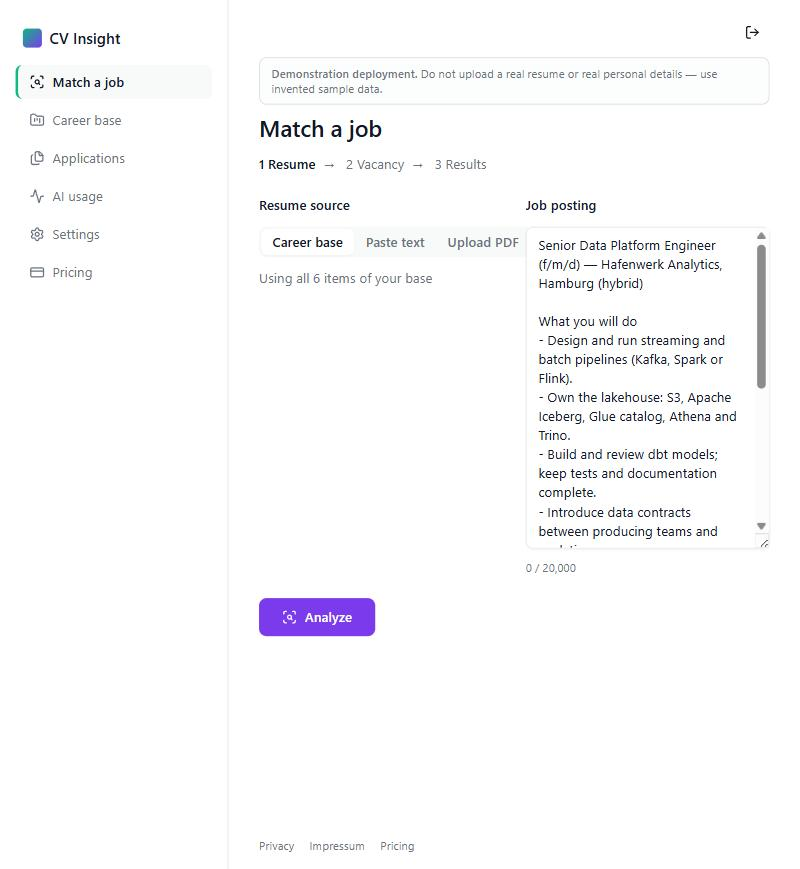
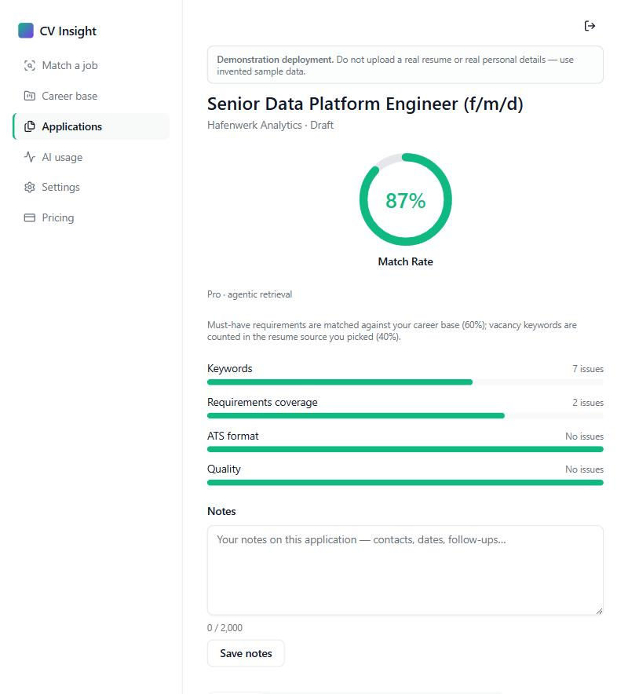
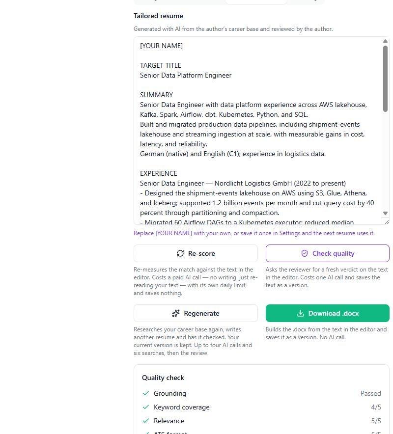
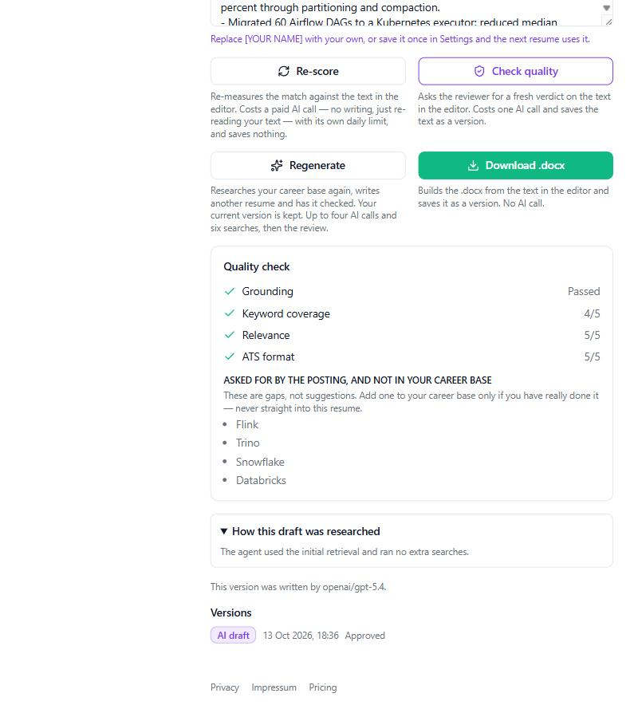
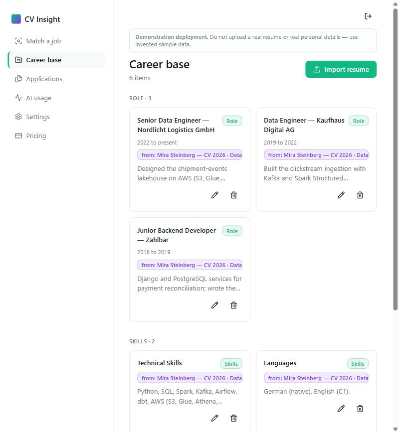
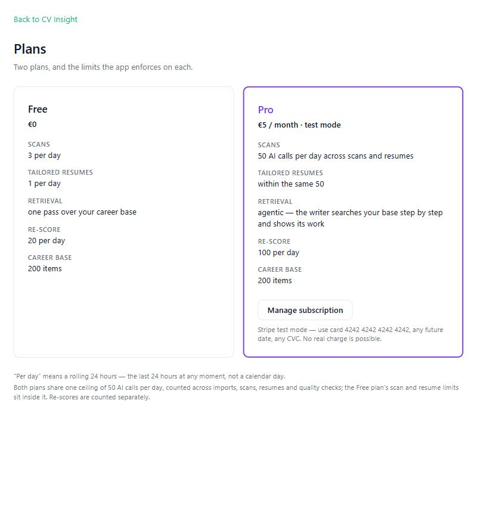
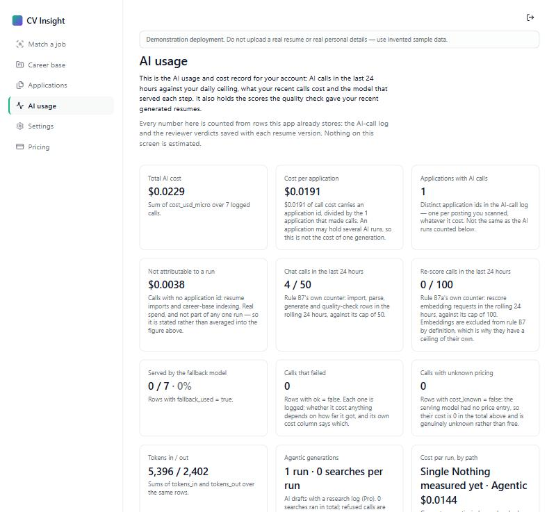

# CV Insight

[](https://github.com/MYkosareva-dev/cv-insight/actions/workflows/ci.yml)

CV Insight helps a job seeker answer two questions about a posting before applying:
how well do I actually match it, and what would my resume look like written for it?
You keep a **career base** — every role, project, skill and achievement, written once
as small items — and for each job you paste the posting into **Match a job**. The app
parses the posting into requirements, scores your career base against them, shows
which requirements are covered and which are gaps, and then writes a tailored resume
using only what your career base actually says. A second model reviews every resume
against a rubric before you see it. On the Pro plan the writer does not stop at one
retrieval pass: it researches your career base step by step through a search tool,
and shows you what it looked for.

Live at **https://cv-insight-lime.vercel.app**. This is a **demonstration
deployment**: do not upload a real resume or real personal details — use invented
sample data.

## Screenshots


*Match a job — pick the resume source, paste the posting, press Analyze.*


*Results — the match rate and where the issues are, on a Pro account using agentic retrieval.*


*Tailored resume — editable, labelled as generated with AI, and every action states what it spends before it runs.*


*Quality check — the reviewer's verdict, the gaps the posting asks for that the career base does not hold, and the research log. Here the agent kept the initial retrieval because a six-item base left nothing more to search.*


*Career base — atomic items, each carrying the import it came from.*


*Pricing — the two plans and the limits the app enforces on each.*


*AI usage — every number counted from the stored AI-call log: cost, calls against the daily ceiling, and which model served each step.*

## How it works

A run follows the stepper on the Match a job screen — **Resume → Vacancy →
Results** — and ends on the **Tailored resume**. The resume source is your career
base, pasted text or an uploaded PDF. The posting is parsed into must-have and
nice-to-have requirements and a keyword list; each requirement is embedded and
matched against your career base with pgvector, and a requirement that names a
specific tool or credential only counts as covered if your career base literally
mentions it, so topical similarity cannot paper over a missing skill. The match
score combines requirement coverage with keyword presence, and the results screen
shows every requirement with the career item that covers it, or the reason it is a
gap. From there you generate the tailored resume, edit it, re-score it, have it
checked again, and download it as `.docx`.

**Single-shot retrieval** (Free) gathers the career items most relevant to the
whole posting in one pass and hands them to the writer as the only material it may
use. Terms the posting asks for and the base does not support are reported
separately and never written into the resume.

**Agentic retrieval** (Pro) starts from that same single-shot result and lets the
writer search the career base itself, through one tool whose only parameter is a
search query, within a fixed budget of four model rounds and six searches. Every
search is logged by query, result count and item title, and the result screen's
research section is drawn from that log; the output then goes through the same
quality check as a Free resume.

Both plans share one ceiling of **50 AI calls per day**, counted across imports,
scans, resumes and quality checks. Inside it, Free allows **3 scans** and
**1 tailored resume** per day; Pro has no per-step allowance beyond the shared 50.
Re-scores are counted separately: **20 per day** on Free, **100** on Pro. The
career base holds up to **200 items** on either plan. "Per day" means a rolling
24 hours, not a calendar day.

## Plans and billing

There are two plans. Free is what every account starts on; Pro costs €5 a month
and raises the limits above and switches generation to agentic retrieval. Billing
runs on Stripe in **test mode** on Stripe-hosted Checkout and Customer Portal pages,
so no real payment is possible: upgrade with the card `4242 4242 4242 4242`, any
future date and any CVC. No card data and no Stripe script ever reach this app.

The plan is never a field anyone can set. It is derived from the latest row of
`subscription_events`, an append-only ledger written only by the Stripe webhook
after it verifies the event's signature: Pro while that row is active or trialing
and its period has not ended, Free otherwise. Users can read their own ledger rows
and nothing more, and a database trigger refuses every edit or delete that is not
the account-erasure cascade. There is no `plan` column anywhere in the schema,
because any column a signed-in user can update would be settable through the
public database endpoint. Both AI gates read the plan right after verifying the
user and refuse before a request to the model exists; no page or button makes the
decision.

## Stack

| Layer | Choice |
|---|---|
| Framework | Next.js 16 (App Router, route handlers, server components), React 19, Tailwind CSS 4 |
| Auth and data | Supabase — Auth, Postgres, pgvector for the career-base index, row-level security on every table; EU (Frankfurt) region |
| AI | OpenRouter, server-side only: `anthropic/claude-haiku-4.5` parses postings, imports resumes and judges; `openai/gpt-5.4` writes the resume on both paths; `google/gemini-2.5-flash` is the fallback for every chat step; `openai/text-embedding-3-small` for embeddings |
| Hosting | Vercel, functions pinned to `fra1` |
| Billing | Stripe in test mode, hosted Checkout and Customer Portal, one webhook |

## Running locally

You need Node 22.18 or newer and a Supabase project with the `vector` extension
enabled. Copy `.env.example` to `.env.local` and fill in the seven variables it
names; only the two `NEXT_PUBLIC_SUPABASE_*` values ever reach the browser, and the
Stripe secret key must be a `sk_test_` key. Apply `supabase/migrations/001` through
`007` in order in the Supabase SQL editor, and turn **Confirm email** off in the
Supabase dashboard, since the app sends no mail of its own.

```bash
npm ci
npm run dev      # http://localhost:3000
npm test         # unit suite
npm run check    # the thirteen boundary rules
npm run build    # runs check and test first, via prebuild
```

To exercise billing locally, forward Stripe's three webhook events to
`localhost:3000/api/stripe/webhook` with the Stripe CLI. [docs/deploy.md](docs/deploy.md)
carries the exact `stripe listen` command, the Stripe dashboard setup, the Vercel
configuration and the post-deploy verification checklist, and is the reference for
everything this section leaves out.

## Quality and safety

`npm run check` enforces thirteen boundary rules that a type-checker cannot see —
database access only through one data-access module per table, no secret name with
a public prefix or outside a `server-only` module, model calls only through the
two gates, no `getSession()` access checks, no `security definer` functions, the
service-role key in one module, session cookies created in two pinned places only,
and no documented path or retention promise without the file or evidence behind
it — and it runs before every build, so a violation fails the deploy instead of
shipping. The unit suite has 506 tests on the pure logic where an arithmetic slip
would hide (scoring, chunking, the judge's verdict, budgets, plans, pricing, the
webhook). The Playwright suite has 51 tests in seven specs; it makes real, paid
model calls, so it runs as a deliberate, recorded run rather than in CI, and its
runs are kept in `docs/eval/`.

Every generated resume carries a line stating it was generated with AI from the
author's career base — above the editor, and appended to the downloaded `.docx`
outside the stored text, so editing cannot remove it. Deleting the account in
Settings removes the user and every row they own, which was witnessed on a
populated account and recorded in
[docs/eval/erasure-evidence.md](docs/eval/erasure-evidence.md).

Every change is a feature branch and a pull request. The `ai-code-reviewer`
subagent reviews each pull request's diff, and its report is saved verbatim in
[docs/reviews/](docs/reviews/) before anything is changed in response; security,
architecture and privacy reviewers run at their own stages. The measurements behind
the design live in [docs/eval/](docs/eval/) — among them the coverage-threshold
calibration, the generation-model comparison, the tool-calling probe, the agentic
versus single-shot comparison, and the billing webhook and erasure evidence.

### How this codebase is built

The reviewers are Claude Code subagents defined in this repository, each reading a
change against `SPEC.md` and `CLAUDE.md`. A stage with no report in `docs/reviews/`
did not run.

| Agent (`.claude/agents/`) | Stage it runs at |
|---|---|
| `ai-architect` | Before implementing each phase, and on any change to the data model, the AI pipeline or the server/client boundary; it also reviews documentation-only PRs at the next phase gate |
| `ai-code-reviewer` | On every pull request, over the full diff, before merge |
| `supabase-security` | After the database phase, after any migration change, and before deploy |
| `nextjs-security` | After each phase that adds pages, route handlers or lib modules, and before deploy |
| `vercel-security` | Before the first deploy, and after any change to environment handling or build config |
| `eu-compliance-reviewer` | On any feature that touches personal data, cookies or public pages, and once before deploy |

| Command (`.claude/commands/`) | Stage it runs at |
|---|---|
| `/full-review` | Before a branch's pull request is opened, as the complete review pass. The command file is a generic template whose `subagent_type` names are not agents defined here; in practice the pass is run with this project's own agents |
| `/team-review` | On a merged phase: fans the review out to `ai-code-reviewer`, `supabase-security`, `nextjs-security` and `ai-architect`, plus `eu-compliance-reviewer` when the diff touches personal data, and consolidates their findings |

## Status and backlog

Open findings, accepted limitations and their reopening conditions are kept in
[docs/backlog.md](docs/backlog.md). This is a test-mode deployment holding invented
data only.
